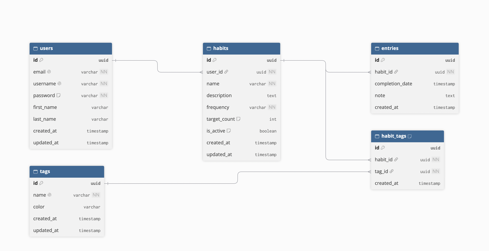

# Reading ER Diagrams & Designing Schemas with dbdiagram.io

## The one-line answer

An **ER (entity-relationship) diagram** is a picture of your database: every **box is a table**, every **line is a foreign key**, and the **shape at each end of a line** tells you "one" or "many". **dbdiagram.io** lets you *type* the tables and draws the picture for you.

---

## 1. The case study: Habit Tracker



> 🔗 **Live diagram:** open the diagram in dbdiagram.io → **Share** → copy the link → paste it here.

The same diagram as plain text (works in any Markdown viewer):

```
┌──────────────┐        ┌──────────────────┐        ┌──────────────────┐
│ users        │        │ habits           │        │ entries          │
├──────────────┤        ├──────────────────┤        ├──────────────────┤
│ 🔑 id        │┼──────<│ 🔑 id            │┼──────<│ 🔑 id            │
│ email   (U)  │        │ 🔗 user_id   NN  │        │ 🔗 habit_id  NN  │
│ username(U)  │        │ name         NN  │        │ completion_date  │
│ password NN  │        │ description      │        │ note             │
│ first_name   │        │ frequency    NN  │        │ created_at       │
│ last_name    │        │ target_count     │        └──────────────────┘
│ created_at   │        │ is_active        │
│ updated_at   │        │ created_at       │
└──────────────┘        │ updated_at       │
                        └──────────────────┘
                                 ┼
                                 │
                                 ^
┌──────────────┐        ┌──────────────────┐
│ tags         │        │ habit_tags  🌉   │
├──────────────┤        ├──────────────────┤
│ 🔑 id        │┼──────<│ 🔑 id            │
│ name    (U)  │        │ 🔗 habit_id  NN  │
│ color        │        │ 🔗 tag_id    NN  │
│ created_at   │        │ created_at       │
│ updated_at   │        │ UNIQUE(habit_id, │
└──────────────┘        │        tag_id)   │
                        └──────────────────┘

  ┼  = "one" side      <  ^  = "many" side (crow's foot)
  🔑 = primary key     🔗 = foreign key    (U) = unique    NN = not null
  Every line = ON DELETE CASCADE
```

### The relationships, line by line

| Line | Read it as | Type |
| --- | --- | --- |
| `users.id ┼──< habits.user_id` | One user has many habits | 1:N |
| `habits.id ┼──< entries.habit_id` | One habit has many entries (ticks) | 1:N |
| `habits.id ┼──< habit_tags.habit_id` | One habit appears in many habit_tags rows | 1:N |
| `tags.id ┼──< habit_tags.tag_id` | One tag appears in many habit_tags rows | 1:N |

The last two lines **together** give **habits ↔ tags = many-to-many**.

> 🔑 **The fork (`<`) always lands on the foreign key row.** That's the rule "the FK lives on the many side" drawn as a picture.

### What happens when a user deletes their account

1. The `users` row is deleted.
2. Their `habits` are deleted (cascade).
3. Those habits' `entries` and `habit_tags` rows are deleted (cascade).
4. `tags` survive, because they're shared and don't belong to one user.

---

## 2. Reading the lines (crow's foot notation)

| Line end | Name | Meaning |
| --- | --- | --- |
| `┼` (tick) | one | Exactly one on this side |
| `<` (three-prong fork) | crow's foot | Many on this side |
| `○┼` | zero or one | Optional one |
| `○<` | zero or many | Optional many |

Read every line as: **"one [tick side] has many [fork side]."**

**Analogy: a family tree's branches.** One trunk splits into many branches, never the other way round. The fork is drawn where the line splits into many.

---

## 3. Spotting many-to-many on a diagram

Databases can't draw many-to-many as a single line. They store it as **two one-to-many lines meeting in a link table**. So you have to *recognise* it.

### Two levels of looking

| Level | Question | Habits ↔ Tags |
| --- | --- | --- |
| **Meaning** (real world) | What does the app allow? | Many-to-many |
| **Storage** (the diagram) | What lines are drawn? | Two 1:N lines into `habit_tags` |

Both are true at the same time.

### The 3-step check

1. **Two (or more) forks land on one table?** Then it's a *candidate* link table.
2. **Is that table mostly just the IDs?** `habit_tags` holds `habit_id + tag_id` (plus `id` and `created_at`). It's a bridge, not a "thing".
3. **Ask both ways:** *"Can one A have many B? Can one B have many A?"* If both answers are yes, it's many-to-many. ✅

⚠️ **Why step 3 matters:** if `entries` also stored `user_id`, it would receive two forks (from `users` and `habits`). But users ↔ habits is **not** many-to-many, because a habit has only one owner. Two forks only make a candidate. The question confirms it.

**Analogy: footballers and clubs.** A player plays for many clubs in a career, and a club has many players. The FA doesn't write ten clubs into the player's file. It keeps a **transfer register**, where each row says "player X joined club Y on this date." The register is the link table.

### Make link tables easy to spot

- Name them `a_b`: `habit_tags`, `user_roles`, `product_categories`.
- In dbdiagram, give them their own header colour (see section 5).

---

## 4. Data types (and what they become in JavaScript)

### Short answer: is `varchar` a string?

**Yes.** `varchar` = **var**iable-length **char**acters = a string in JS. `varchar(255)` means "a string of at most 255 characters". The database rejects anything longer.

### The full cheat sheet (PostgreSQL)

#### Text

| Postgres type | JS type | Use for | Notes |
| --- | --- | --- | --- |
| `varchar(n)` | `string` | Names, emails, usernames | Max length `n` enforced |
| `text` | `string` | Descriptions, notes, long content | No length limit |
| `char(n)` | `string` | Fixed-length codes (`NGN`, country codes) | Pads with spaces. Rarely used |

> In Postgres, `varchar(n)` and `text` perform the same. Use `varchar(n)` when a **limit is a business rule** (a BVN is 11 digits), and `text` when it isn't.

#### Numbers

| Postgres type | JS type | Range / use | Notes |
| --- | --- | --- | --- |
| `smallint` | `number` | -32,768 to 32,767 | Small counters |
| `integer` / `int` | `number` | About ±2.1 billion | Counts, `target_count` |
| `bigint` | ⚠️ `string` (or `bigint`) | Huge numbers | The `pg` driver returns it as a **string** to avoid losing precision |
| `serial` / `bigserial` | `number` / `string` | Auto-increment IDs (1, 2, 3…) | Older ID style. `uuid` is common now |
| `numeric(p, s)` / `decimal` | ⚠️ `string` | **Money**, exact decimals | `numeric(12, 2)` = up to 12 digits, 2 after the point. Returned as a string so no kobo is lost |
| `real` / `double precision` | `number` | Scientific values, measurements | **Never for money**: `0.1 + 0.2 !== 0.3` |

> 💰 **Fintech rule:** money is **`numeric`** (or an integer in kobo, e.g. ₦50.25 → `5025`). It's **never** `real` or `double`.

#### True/false, IDs, dates

| Postgres type | JS type | Use for | Notes |
| --- | --- | --- | --- |
| `boolean` | `boolean` | `is_active`, `is_verified` | `true` / `false` / `NULL` |
| `uuid` | `string` | Primary keys | `'3f2b…-…'`. Random, so IDs can't be guessed |
| `date` | `string` / `Date` | Birthdays, due dates | Day only, no time |
| `time` | `string` | Opening hours | Time only |
| `timestamp` | `Date` | Event times | ⚠️ No timezone stored |
| `timestamptz` | `Date` | **Prefer this** for `created_at` etc. | Stores in UTC and converts correctly. Safest across Lagos ↔ London servers |
| `interval` | `object` / `string` | Durations ("3 days") | |

#### Structured & special

| Postgres type | JS type | Use for | Notes |
| --- | --- | --- | --- |
| `jsonb` | `object` / `array` | Flexible extra data, settings, API payloads | Indexable and queryable. Prefer it over `json` |
| `json` | `object` / `array` | Same, stored as raw text | Slower to query |
| `text[]`, `int[]` | `string[]`, `number[]` | Simple lists | Don't use arrays to fake relationships. Use a link table |
| `enum` (custom) | `string` union | Fixed choices: `'daily' \| 'weekly'` | The DB rejects any other value |
| `bytea` | `Buffer` | Small binary data | Store files in object storage instead, and keep only the URL |

### Constraints you'll see beside the types

| Label | Meaning |
| --- | --- |
| `PK` / 🔑 | Primary key: unique, never null, the row's official ID |
| `FK` / 🔗 | Foreign key: must match an `id` that exists in another table |
| `NN` / `not null` | Can't be empty |
| `unique` / fingerprint icon | No two rows can share this value |
| `default` | Value used when you don't send one (`now()`, `true`, `1`) |
| `on delete cascade` | Delete the parent and its children go with it |

---

## 5. Designing future schemas with dbdiagram.io

### The workflow

```
1. THINK        →  2. TYPE (DBML)      →  3. CHECK         →  4. GENERATE
nouns = tables     dbdiagram draws it     5-step recipe       Drizzle schema
"one or many?"     live as you type       + "ask both ways"   (AI converts DBML)
```

### The 5-step recipe (do this before typing)

1. **Find the nouns** → each noun is a table.
2. **Give every table** `id`, `created_at`, `updated_at`.
3. **For each pair of tables ask both ways:** one A → many B? one B → many A?
4. **Apply:** one side many → FK on the many side. Both many → link table. Both one → FK + `unique`.
5. **Add guards:** `unique`, `not null`, `on delete` behaviour.

### DBML syntax cheat sheet

```dbml
Table users {
  id uuid [pk]
  email varchar(255) [unique, not null]
  is_active boolean [default: true]
  created_at timestamptz [default: `now()`]
  balance numeric(12,2) [note: 'Money: never float']
}
```

| You want | DBML |
| --- | --- |
| Primary key | `[pk]` |
| Unique | `[unique]` |
| Not null | `[not null]` |
| Default value | `[default: true]`, `[default: 1]`, ``[default: `now()`]`` |
| Note on a column | `[note: 'hashed']` |
| Auto-increment | `[pk, increment]` |
| Unique pair | `indexes { (habit_id, tag_id) [unique] }` |
| Colour a table header | `Table habit_tags [headercolor: #8E44AD] { … }` |

### Relationship symbols

| Symbol | Meaning | Example |
| --- | --- | --- |
| `>` | many-to-one | `Ref: habits.user_id > users.id` |
| `<` | one-to-many | `Ref: users.id < habits.user_id` |
| `-` | one-to-one | `Ref: kyc_profiles.user_id - users.id` |
| `<>` | **many-to-many** | `Ref: habits.id <> tags.id` |

Add delete behaviour like this: `Ref: habits.user_id > users.id [delete: cascade]`

> ✨ **`<>` lets you design at the "meaning" level.** You draw one many-to-many line, and when you export to SQL, dbdiagram generates the link table for you. Keep an explicit link table (like `habit_tags`) when the link needs its own data, such as `created_at`.

### Convention: colour your link tables

```dbml
Table habit_tags [headercolor: #8E44AD, note: 'LINK TABLE: habits <> tags'] {
  id uuid [pk]
  habit_id uuid [not null]
  tag_id uuid [not null]
  created_at timestamptz [default: `now()`]
  indexes {
    (habit_id, tag_id) [unique]
  }
}
```

A purple header always means "bridge table" in every diagram you make.

### Exporting

- **Export → PNG / PDF** gives a picture for docs and PRs (save it in `docs/images/`).
- **Export → PostgreSQL** gives ready-to-run `CREATE TABLE` SQL.
- **Share → link** gives a live, always-up-to-date cloud version to paste into docs.

### Speed tips

- **AI first draft:** describe the app in plain English → ask for DBML → paste into dbdiagram → review with the recipe.
- **AI conversion:** paste the finished DBML → *"Convert to a Drizzle Postgres schema with cascade deletes."*
- **AI review:** paste any schema → *"List every relationship in plain English and flag any many-to-many."*
- **Reverse it:** for an existing database, Drizzle Studio, ChartDB or pgAdmin's ERD tool can draw the diagram for you.

---

## 6. Full DBML for the habit tracker

```dbml
Table users {
  id uuid [pk]
  email varchar(255) [unique, not null]
  username varchar(50) [unique, not null]
  password varchar(255) [not null, note: 'hashed']
  first_name varchar(50)
  last_name varchar(50)
  created_at timestamptz [default: `now()`]
  updated_at timestamptz [default: `now()`]
}

Table habits {
  id uuid [pk]
  user_id uuid [not null]
  name varchar(100) [not null]
  description text
  frequency varchar(20) [not null, note: 'daily | weekly']
  target_count int [default: 1]
  is_active boolean [default: true]
  created_at timestamptz [default: `now()`]
  updated_at timestamptz [default: `now()`]
}

Table entries {
  id uuid [pk]
  habit_id uuid [not null]
  completion_date timestamptz [default: `now()`]
  note text
  created_at timestamptz [default: `now()`]
}

Table tags {
  id uuid [pk]
  name varchar(50) [unique, not null]
  color varchar(7) [default: '#6B7280']
  created_at timestamptz [default: `now()`]
  updated_at timestamptz [default: `now()`]
}

Table habit_tags [headercolor: #8E44AD, note: 'LINK TABLE: habits <> tags'] {
  id uuid [pk]
  habit_id uuid [not null]
  tag_id uuid [not null]
  created_at timestamptz [default: `now()`]
  indexes {
    (habit_id, tag_id) [unique]
  }
}

Ref: habits.user_id > users.id [delete: cascade]
Ref: entries.habit_id > habits.id [delete: cascade]
Ref: habit_tags.habit_id > habits.id [delete: cascade]
Ref: habit_tags.tag_id > tags.id [delete: cascade]
```

---

## Gotchas

**1. Mistaking a FK for a PK.** `habits.user_id` repeats (one user, many habits), so it can never be the primary key. Every table needs its **own** `id`.

**2. Thinking a column "belongs" to another table.** `habit_tags.created_at` is when the tag was **attached**, not when the tag was created. A column belongs to the table it sits in. FKs copy only the **ID value**.

**3. Assuming two forks always mean many-to-many.** Always confirm with "ask both ways".

**4. Using `real`/`double` for money.** Use `numeric(p, s)` or integer kobo.

**5. Surprise strings from the driver.** `bigint` and `numeric` come back as **strings** in Node. Convert deliberately.

**6. `timestamp` without a timezone.** Prefer `timestamptz`.

**7. Forgetting `UNIQUE` on a link table's pair.** Without it, the same tag can be attached to a habit twice.

---

## Interview Q&A

**Q: In an ER diagram, what do the tick and the crow's foot mean?**
A: The tick (`┼`) is the "one" side. The crow's foot (`<`) is the "many" side, and it sits on the foreign key column.

**Q: How do you represent many-to-many in a relational database?**
A: With a link (junction) table holding a foreign key to each side. It's two one-to-many relationships meeting in the middle, usually with a unique constraint on the pair.

**Q: Looking at a diagram, how do you identify a many-to-many?**
A: Find a table receiving forks from two tables that holds little more than those two IDs, then confirm by asking both ways whether each side can have many of the other.

**Q: Does `varchar` map to a JS string? What's the difference from `text`?**
A: Yes, both are strings. `varchar(n)` enforces a maximum length, and `text` has no limit. In Postgres they perform the same.

**Q: What type would you use for money, and why?**
A: `numeric(p, s)` or an integer in the smallest unit (kobo). Floats can't represent decimals exactly, so they cause rounding errors.

**Q: What does `ON DELETE CASCADE` do?**
A: When the parent row is deleted, the database deletes the child rows that reference it automatically. For example, delete a user and their habits and entries go too.

**Q: `timestamp` vs `timestamptz`?**
A: `timestamptz` stores the moment in UTC and converts it for each timezone. `timestamp` stores no timezone, which causes bugs when servers or users are in different zones.
