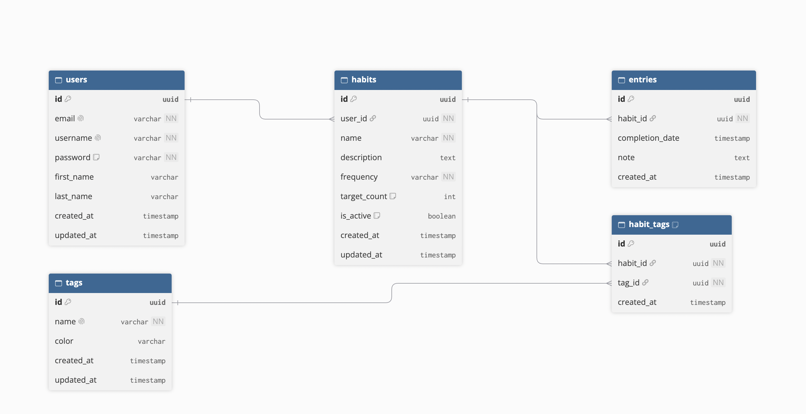

# Reading ER Diagrams

## The one-line answer

An **ER (entity-relationship) diagram** is a picture of your database: every **box is a table**, every **line is a foreign key**, and the **shape at each end of a line** tells you "one" or "many".

---

## The case study: Habit Tracker



> 🔗 **Live diagram:** open the diagram in dbdiagram.io → **Share** → copy the link → paste it here.

The same diagram as plain text (works in any Markdown viewer):

```
┌──────────────┐        ┌──────────────────┐        ┌──────────────────┐
│ users        │        │ habits           │        │ entries          │
├──────────────┤        ├──────────────────┤        ├──────────────────┤
│ 🔑 id        │┼──────<│ 🔑 id            │┼──────<│ 🔑 id            │
│ email   (U)  │        │ 🔗 user_id   NN  │        │ 🔗 habit_id  NN  │
│ username(U)  │        │ name         NN  │        │ completion_date  │
│ password NN  │        │ description      │        │ note             │
│ first_name   │        │ frequency    NN  │        │ created_at       │
│ last_name    │        │ target_count     │        └──────────────────┘
│ created_at   │        │ is_active        │
│ updated_at   │        │ created_at       │
└──────────────┘        │ updated_at       │
                        └──────────────────┘
                                 ┼
                                 │
                                 ^
┌──────────────┐        ┌──────────────────┐
│ tags         │        │ habit_tags  🌉   │
├──────────────┤        ├──────────────────┤
│ 🔑 id        │┼──────<│ 🔑 id            │
│ name    (U)  │        │ 🔗 habit_id  NN  │
│ color        │        │ 🔗 tag_id    NN  │
│ created_at   │        │ created_at       │
│ updated_at   │        │ UNIQUE(habit_id, │
└──────────────┘        │        tag_id)   │
                        └──────────────────┘

  ┼  = "one" side      <  ^  = "many" side (crow's foot)
  🔑 = primary key     🔗 = foreign key    (U) = unique    NN = not null
  Every line = ON DELETE CASCADE
```

### The relationships, line by line

| Line | Read it as | Type |
| --- | --- | --- |
| `users.id ┼──< habits.user_id` | One user has many habits | 1:N |
| `habits.id ┼──< entries.habit_id` | One habit has many entries (ticks) | 1:N |
| `habits.id ┼──< habit_tags.habit_id` | One habit appears in many habit_tags rows | 1:N |
| `tags.id ┼──< habit_tags.tag_id` | One tag appears in many habit_tags rows | 1:N |

The last two lines **together** give **habits ↔ tags = many-to-many**.

> 🔑 **The fork (`<`) always lands on the foreign key row.** That's the rule "the FK lives on the many side" drawn as a picture.

### What happens when a user deletes their account

1. The `users` row is deleted.
2. Their `habits` are deleted (cascade).
3. Those habits' `entries` and `habit_tags` rows are deleted (cascade).
4. `tags` survive, because they're shared and don't belong to one user.

---

## Reading the lines (crow's foot notation)

| Line end | Name | Meaning |
| --- | --- | --- |
| `┼` (tick) | one | Exactly one on this side |
| `<` (three-prong fork) | crow's foot | Many on this side |
| `○┼` | zero or one | Optional one |
| `○<` | zero or many | Optional many |

Read every line as: **"one [tick side] has many [fork side]."**

**Analogy: a family tree's branches.** One trunk splits into many branches, never the other way round. The fork is drawn where the line splits into many.

---

## Spotting many-to-many on a diagram

Databases can't draw many-to-many as a single line. They store it as **two one-to-many lines meeting in a link table**. So you have to *recognise* it.

### Two levels of looking

| Level | Question | Habits ↔ Tags |
| --- | --- | --- |
| **Meaning** (real world) | What does the app allow? | Many-to-many |
| **Storage** (the diagram) | What lines are drawn? | Two 1:N lines into `habit_tags` |

Both are true at the same time.

### The 3-step check

1. **Two (or more) forks land on one table?** Then it's a *candidate* link table.
2. **Is that table mostly just the IDs?** `habit_tags` holds `habit_id + tag_id` (plus `id` and `created_at`). It's a bridge, not a "thing".
3. **Ask both ways:** *"Can one A have many B? Can one B have many A?"* If both answers are yes, it's many-to-many. ✅

⚠️ **Why step 3 matters:** if `entries` also stored `user_id`, it would receive two forks (from `users` and `habits`). But users ↔ habits is **not** many-to-many, because a habit has only one owner. Two forks only make a candidate. The question confirms it.

**Analogy: footballers and clubs.** A player plays for many clubs in a career, and a club has many players. The FA doesn't write ten clubs into the player's file. It keeps a **transfer register**, where each row says "player X joined club Y on this date." The register is the link table.

### Make link tables easy to spot

- Name them `a_b`: `habit_tags`, `user_roles`, `product_categories`.
- In dbdiagram, give them their own header colour (see [note 12](./12-designing-schemas-with-dbdiagram.md)).

---

## Gotchas

**1. Mistaking a FK for a PK.** `habits.user_id` repeats (one user, many habits), so it can never be the primary key. Every table needs its **own** `id`.

**2. Thinking a column "belongs" to another table.** `habit_tags.created_at` is when the tag was **attached**, not when the tag was created. A column belongs to the table it sits in. FKs copy only the **ID value**.

**3. Assuming two forks always mean many-to-many.** Always confirm with "ask both ways".

## Interview Q&A

**Q: In an ER diagram, what do the tick and the crow's foot mean?**
A: The tick (`┼`) is the "one" side. The crow's foot (`<`) is the "many" side, and it sits on the foreign key column.

**Q: How do you represent many-to-many in a relational database?**
A: With a link (junction) table holding a foreign key to each side. It's two one-to-many relationships meeting in the middle, usually with a unique constraint on the pair.

**Q: Looking at a diagram, how do you identify a many-to-many?**
A: Find a table receiving forks from two tables that holds little more than those two IDs, then confirm by asking both ways whether each side can have many of the other.

**Q: What does `ON DELETE CASCADE` do?**
A: When the parent row is deleted, the database deletes the child rows that reference it automatically. For example, delete a user and their habits and entries go too.

---

**Series:** **10 Reading ER diagrams** · [11 Postgres data types](./11-postgres-data-types.md) · [12 Designing with dbdiagram](./12-designing-schemas-with-dbdiagram.md) · [13 Drizzle relations](./13-drizzle-relations-from-diagrams.md) · [14 Prisma](./14-prisma-schema-and-relations.md)
