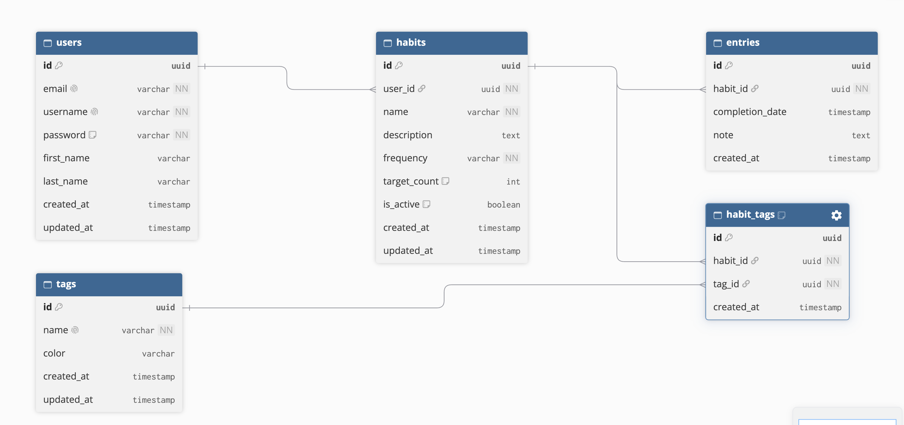

# Writing Drizzle `relations()` from an ER Diagram

## The one-line answer

`relations()` tells Drizzle's query API how tables connect so you can load nested data with `with: {...}`. You don't need to memorise it: read it straight off the ER diagram with three cheat codes.



## First, the foundation: why the FK sits on the "child"

Coming from frontend, your brain expects the **parent to hold its children**, because that's how JSON works:

```json
{ "name": "Michael", "accounts": [ {...}, {...}, {...} ] }
```

A table can't do that. **One cell holds one value.** Try storing accounts on the customer:

| id | name | account_id_1 | account_id_2 | account_id_3 | … |
| --- | --- | --- | --- | --- | --- |
| c1 | Michael | a1 | a2 | ??? | how many columns? |

You'd need an unknown number of columns. Now flip it, so each account stores its owner:

| id | account_number | customer_id |
| --- | --- | --- |
| a1 | 0123456789 | c1 |
| a2 | 0987654321 | c1 |

Each account has **exactly one** owner, so **one cell is always enough**, forever.

> 📏 **Rule:** store the link on the side where the answer is **"ONE."**
> "How many owners does an account have?" One, so the FK goes on `accounts`.

**Two layers, pointing in opposite directions on purpose:**

| Layer | Direction | Why |
| --- | --- | --- |
| **Storage** (`.references()` on columns) | child → parent ("I belong to c1") | One cell = one value |
| **Reading** (`relations()` + `with`) | parent → children ("I have many") | Gives you back the JSON view |

> 📝 **Analogy: a printed form.** An account-opening form has one box, "Customer ID: [ ]", and one box is always enough. A customer form can't have a box for "all your future accounts." Forms have fixed boxes, and so do tables.

## Two systems that don't read each other's notes

| Code | Read by | Job |
| --- | --- | --- |
| `.references(() => habits.id, { onDelete: 'cascade' })` | **Postgres** (via migrations) | Guards data: rejects bad IDs, cascades deletes |
| `relations()` | **Drizzle's query helper** | Powers `db.query.x.findMany({ with: {...} })` |

`relations()` **ignores** `.references()`, so you describe each link again. That's why it feels like repetition: **it is** repetition, for a different reader.

> 🏢 **A security guard and a receptionist.** The guard's rulebook (`.references()`) enforces "no entry without a valid flat number." The receptionist's directory (`relations()`) tells visitors who lives where. She never reads his rulebook, so she keeps her own.

## Every relationship is one equation

Every line in the diagram boils down to one equation, `FK column = id`:

```
habits.userId     = users.id
entries.habitId   = habits.id
habitTags.habitId = habits.id
habitTags.tagId   = tags.id
```

- Each equation is written **once**, inside a `one(…, { fields, references })`, in the relations of the table that **owns the FK column**.
- `fields` = the left side (**mine**: **F**oreign key). `references` = the right side (**theirs**: **R**eal ID).
- `many()` writes **no equation**. It says "use that same equation, from my side." Drizzle finds it in the other table's `one()`.

---

## 🕹️ Cheat code 1: Read the FAR end of the line

Stand at your table, follow each line across, and read the **symbol at the other end**:

| Symbol at the far end | You write |
| --- | --- |
| `┼` (tick = one) | `one(thatTable, …)` |
| `<` (fork = many) | `many(thatTable)` |

**Worked through the habit tracker:**

| I am… | Line goes to… | Far end | I write |
| --- | --- | --- | --- |
| `users` | habits | `<` fork | `habits: many(habits)` |
| `habits` | users | `┼` tick | `user: one(users, …)` |
| `habits` | entries | `<` fork | `entries: many(entries)` |
| `habits` | habit_tags | `<` fork | `habitTags: many(habitTags)` |
| `entries` | habits | `┼` tick | `habit: one(habits, …)` |
| `tags` | habit_tags | `<` fork | `habitTags: many(habitTags)` |
| `habit_tags` | habits | `┼` tick | `habit: one(habits, …)` |
| `habit_tags` | tags | `┼` tick | `tag: one(tags, …)` |

**Naming:** `one()` → **singular** name (returns an object). `many()` → **plural** name (returns an array).

---

## 🕹️ Cheat code 2: Fork on MY end means my `one()` gets the config

Look at **your own end** of the line:

| Symbol on MY end | Meaning | Config? |
| --- | --- | --- |
| `<` fork touches **my** row | I own the FK column (🔗) → I write the equation | ✅ `one(them, { fields: [me.fk], references: [them.id] })` |
| `┼` tick on my end | They own the FK | ❌ bare `many(them)` (or bare `one(them)` for 1:1) |

In the picture, the forks touch exactly these rows, so these are the only places with `{ fields, references }`:

```
habits.user_id      →  habitRelations       user: one(users,  { fields: [habits.userId],     references: [users.id]  })
entries.habit_id    →  entriesRelations     habit: one(habits, { fields: [entries.habitId],   references: [habits.id] })
habit_tags.habit_id →  habitTagsRelations   habit: one(habits, { fields: [habitTags.habitId], references: [habits.id] })
habit_tags.tag_id   →  habitTagsRelations   tag:  one(tags,   { fields: [habitTags.tagId],   references: [tags.id]   })
```

**Self-check:** inside `relations(X, …)`, every `fields: [...]` must start with `X.` If you see `fields: [entries.habitId]` inside `relations(habits, …)`, it's in the wrong block.

---

## 🕹️ Cheat code 3: Count before you write

| Count in the picture | Tells you | Habit tracker |
| --- | --- | --- |
| **Tables with at least one line** | Number of `relations()` blocks | **5** |
| **Lines** | Number of `one()`s **with** `{ fields, references }` | **4** |
| **Lines × 2** | Total entries across all blocks (each line = one half on each side) | **8** |

Check: users (1) + habits (3) + entries (1) + tags (1) + habit_tags (2) = **8** ✅

A table with **no lines** (e.g. a standalone `settings` table) needs **no** `relations()` block.

---

## The result: the full relations for the habit tracker

```ts
export const userRelations = relations(users, ({ many }) => ({
  habits: many(habits),                      // far end: fork
}))

export const habitRelations = relations(habits, ({ one, many }) => ({
  user: one(users, {                         // far end: tick · fork on MY end → config
    fields: [habits.userId],
    references: [users.id],
  }),
  entries: many(entries),                    // far end: fork
  habitTags: many(habitTags),                // far end: fork
}))

export const entriesRelations = relations(entries, ({ one }) => ({
  habit: one(habits, {                       // far end: tick · fork on MY end → config
    fields: [entries.habitId],
    references: [habits.id],
  }),
}))

export const tagsRelationships = relations(tags, ({ many }) => ({
  habitTags: many(habitTags),                // far end: fork
}))

export const habitTagsRelationships = relations(habitTags, ({ one }) => ({
  habit: one(habits, {                       // far end: tick · fork on MY end → config
    fields: [habitTags.habitId],
    references: [habits.id],
  }),
  tag: one(tags, {                           // far end: tick · fork on MY end → config
    fields: [habitTags.tagId],
    references: [tags.id],
  }),
}))
```

## What you get: nested data like a JSON response

```ts
const habit = await db.query.habits.findFirst({
  with: {
    user: true,                              // one()  → object
    entries: true,                           // many() → array
    habitTags: { with: { tag: true } },      // walk across the bridge
  },
})
```

```json
{
  "name": "Read 30 mins",
  "user": { "email": "michael@..." },
  "entries": [ { "note": "Done!" }, { "note": null } ],
  "habitTags": [ { "tag": { "name": "Health", "color": "#22c55e" } } ]
}
```

## Edge cases the cheat codes still handle

**One-to-one (`┼──┼`).** There are ticks on both ends, so both sides write `one()`. Only the side that owns the FK column (🔗, usually also `unique`) gets the config:

```ts
// users ┼──┼ kyc_profiles (kycProfiles.userId is FK + unique)
usersRelations       → kycProfile: one(kycProfiles)                 // no config
kycProfilesRelations → user: one(users, { fields: [kycProfiles.userId], references: [users.id] })
```

**Many-to-many: never skip the bridge.** There's **no line** between `habits` and `tags`, so there's no `tags: many(tags)` on habits. Only follow lines that exist. To reach tags, walk the bridge: `habitTags: { with: { tag: true } }`.

> ✅ **Rule:** before writing `many(X)`, check that a line connects you to X with a fork at X's end. `tags` has no `habitId` column, so `many(tags)` on habits is wrong.

**Two lines between the same two tables** (e.g. `habits.ownerId` and `habits.createdById` both → `users`). Drizzle can't guess which `many()` pairs with which `one()`. Give both halves the same `relationName`:

```ts
owner:       one(users, { fields: [habits.ownerId], references: [users.id], relationName: 'owner' })
ownedHabits: many(habits, { relationName: 'owner' })
```

## Prove it to yourself (3 experiments)

Run `db.query.habits.findFirst({ with: { entries: true } })` after each change, then undo it:

| # | Change | What happens | What it proves |
| --- | --- | --- | --- |
| 1 | Delete the `one()` in `entriesRelations` | Error: not enough information to infer the relation | `many()` borrows the equation from the other side's `one()` |
| 2 | Remove `.references()` from `entries.habitId` | The query **still works** | `relations()` doesn't read `.references()` |
| 3 | Remove `entries: many(entries)` from habits | TypeScript rejects `with: { entries: true }` | `many()` is what switches the relation on |

## The sticky note

1. **Far end tick** → `one()`. **Far end fork** → `many()`.
2. **Fork on my end** → my `one()` gets `{ fields: [mine], references: [theirs] }`.
3. **Count:** tables with lines = blocks · lines = config `one()`s · lines × 2 = total entries.
4. `one` = singular = object · `many` = plural = array.
5. `relations()` doesn't touch the database. It's the map for `with: {}`.

## Gotchas

**1. Copy-pasting `pgTable('habits', …)` for every table.** The string is the real table name in Postgres. The variable name doesn't matter to the database.

**2. Writing `one()` with config in the wrong block.** `fields: [X.col]` must sit inside `relations(X, …)`.

**3. `many()` to a table with no line to you** (e.g. `tags: many(tags)` on habits). Go through the bridge table.

## Interview Q&A

**Q: In Drizzle, what's the difference between `.references()` and `relations()`?**
A: `.references()` creates the real foreign key in Postgres (data safety, cascades). `relations()` creates nothing in the database. It tells Drizzle's query API how to load related data with `with`.

**Q: Why does `many()` take no `fields`/`references`?**
A: The table it points to owns the FK column, so that table's `one()` holds the equation. `many()` reuses that same equation from the other side.

**Q: Why does the foreign key go on the "many" side?**
A: A cell holds one value. Each child has exactly one parent, so one column is enough. A parent with many children would need an unknown number of columns.

---

**Series:** [10 Reading ER diagrams](./10-reading-er-diagrams.md) · [11 Postgres data types](./11-postgres-data-types.md) · [12 Designing with dbdiagram](./12-designing-schemas-with-dbdiagram.md) · **13 Drizzle relations** · [14 Prisma](./14-prisma-schema-and-relations.md)
