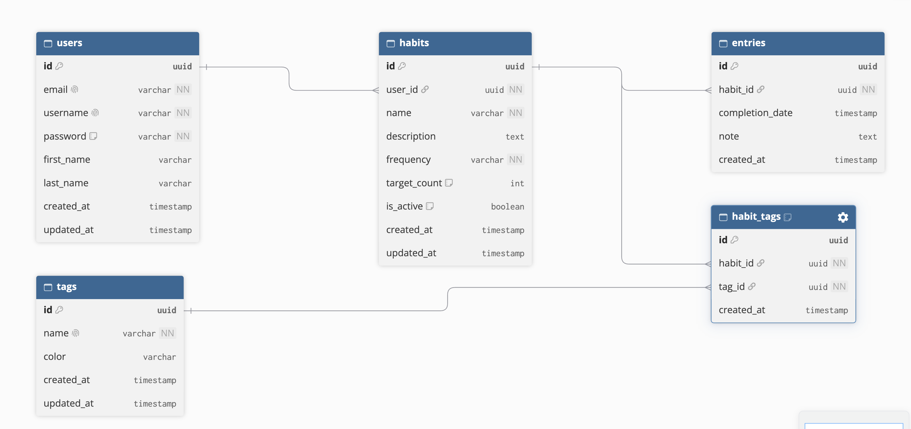

# Prisma: Schema & Relations

## The one-line answer

**Prisma** describes your database in its own `schema.prisma` file. Each **`model`** is a table. Relations are written **inside the models themselves**: the parent shows its children as an array (`habits Habit[]`), and the child holds the foreign key with `@relation(...)`. One line in Prisma does what Drizzle needs `.references()` **and** `relations()` for.

> 📄 **The schema for this project:** [`src/db/schema.prisma`](../src/db/schema.prisma), the same 5 tables, columns and cascades as `src/db/schema.ts`.



---

## 1. Reading a Prisma model

```prisma
model Habit {
  id          String    @id @default(uuid()) @db.Uuid
  userId      String    @map("user_id") @db.Uuid
  name        String    @db.VarChar(200)
  description String?
  isActive    Boolean   @default(true) @map("is_active")
  updatedAt   DateTime? @default(now()) @updatedAt @map("updated_at")

  user      User       @relation(fields: [userId], references: [id], onDelete: Cascade)
  entries   Entry[]
  habitTags HabitTag[]

  @@map("habits")
}
```

Every field line has three parts: **name · type · attributes**.

```
  name        String?      @db.VarChar(200)
  ▲           ▲      ▲     ▲
  field name  type   │     attributes (rules)
                     └── ? = optional (can be NULL)
```

### The attributes you'll see most

| Attribute | Meaning | Drizzle equivalent |
| --- | --- | --- |
| `@id` | Primary key | `.primaryKey()` |
| `@default(uuid())` | Generate a UUID automatically | `.defaultRandom()` |
| `@default(now())` | Set to the current time on insert | `.defaultNow()` |
| `@updatedAt` | Prisma sets it to now on **every update** | (manual in Drizzle) |
| `@unique` | No duplicates | `.unique()` |
| `?` after the type | Optional (nullable) | no `.notNull()` |
| no `?` | Required (`NOT NULL`) | `.notNull()` |
| `@map("user_id")` | The real **column** name in the DB | `uuid('user_id')` |
| `@@map("habits")` | The real **table** name in the DB | `pgTable('habits', …)` |
| `@db.VarChar(200)` | The exact Postgres type | `varchar('name', { length: 200 })` |
| `@@unique([a, b])` | Unique **pair** of columns | `unique().on(t.a, t.b)` |

> `@` = about **one field**. `@@` = about the **whole model**.

**Naming convention:** models are `PascalCase` and singular (`Habit`). `@@map` gives the real snake_case plural table name (`habits`). Fields are `camelCase` (`userId`), and `@map` gives the snake_case column name (`user_id`).

---

## 2. Types: Prisma → Postgres → JavaScript

| Prisma type | Default Postgres type | With `@db.…` | JS type you get | Notes |
| --- | --- | --- | --- | --- |
| `String` | `text` | `@db.VarChar(n)`, `@db.Uuid`, `@db.Char(n)` | `string` | Plain `String` = unlimited `text` |
| `Int` | `integer` | `@db.SmallInt` | `number` | |
| `BigInt` | `bigint` | | `bigint` | Write literals as `10n` |
| `Float` | `double precision` | `@db.Real` | `number` | ❌ Never for money |
| `Decimal` | `numeric(65,30)` | `@db.Decimal(14, 2)` | `Prisma.Decimal` object | ✅ Use for money. Call `.toString()` or `.toNumber()` |
| `Boolean` | `boolean` | | `boolean` | |
| `DateTime` | `timestamp(3)` | `@db.Timestamptz(3)`, `@db.Date` | `Date` | Prefer `@db.Timestamptz` for real apps |
| `Json` | `jsonb` | | object / array | |
| `Bytes` | `bytea` | | `Uint8Array` | |
| `enum Frequency { daily weekly }` | Postgres enum | | string union | The DB rejects other values |

---

## 3. The key idea: two kinds of fields

Inside a model there are **two kinds** of field, and telling them apart is the whole trick:

| Kind | Example | Is it a DB column? | How to spot it |
| --- | --- | --- | --- |
| **Scalar field** | `userId String` | ✅ Yes, a real column | Type is a basic type (`String`, `Int`, …) |
| **Relation field** | `user User`, `entries Entry[]` | ❌ No, it's a **virtual** link for queries | Type is **another model's name** |

```prisma
model Habit {
  userId  String                                              // 🧱 scalar: the real FK column
  user    User     @relation(fields: [userId], references: [id]) // 🔗 relation: uses userId
  entries Entry[]                                             // 🔗 relation: no column at all
}
```

> 📱 **Analogy: a contact card on your phone.** The phone number is real data stored on the card (the scalar field). The **"Call"** and **"WhatsApp"** buttons aren't stored data. They're shortcuts that use the number to take you somewhere (relation fields). `user User` is the button, and `userId` is the number it dials.

Because relation fields aren't columns, **the parent can show `habits Habit[]` without breaking "one cell = one value."** The FK still physically lives on the child (`Habit.userId`). Prisma just lets you see the array on the parent, like JSON.

---

## 4. Relations: the same cheat codes, Prisma spelling

Your three diagram cheat codes from [note 13](./13-drizzle-relations-from-diagrams.md) still apply:

| Cheat code | Drizzle | Prisma |
| --- | --- | --- |
| **1. Far end tick** → one | `user: one(users, …)` | `user User` |
| **1. Far end fork** → many | `habits: many(habits)` | `habits Habit[]` |
| **2. Fork on MY end** → I hold the equation | `one(users, { fields: [habits.userId], references: [users.id] })` | `user User @relation(fields: [userId], references: [id])` |
| **3. Count** | lines = config `one()`s | lines = `@relation(fields…)` lines |

**Worked through the diagram:**

| Model | Line to | Far end | Fork on my end? | Prisma field |
| --- | --- | --- | --- | --- |
| `User` | habits | fork | no | `habits Habit[]` |
| `Habit` | users | tick | **yes** | `user User @relation(fields: [userId], references: [id], onDelete: Cascade)` |
| `Habit` | entries | fork | no | `entries Entry[]` |
| `Habit` | habit_tags | fork | no | `habitTags HabitTag[]` |
| `Entry` | habits | tick | **yes** | `habit Habit @relation(fields: [habitId], references: [id], onDelete: Cascade)` |
| `Tag` | habit_tags | fork | no | `habitTags HabitTag[]` |
| `HabitTag` | habits | tick | **yes** | `habit Habit @relation(fields: [habitId], references: [id], onDelete: Cascade)` |
| `HabitTag` | tags | tick | **yes** | `tag Tag @relation(fields: [tagId], references: [id], onDelete: Cascade)` |

4 lines → 4 `@relation(fields…)` ✅ · 8 relation fields in total ✅

### Prisma's built-in safety check

Prisma **requires both sides** of every relation. If you write `user User @relation(...)` on `Habit` but forget `habits Habit[]` on `User`, it refuses to run.

> 💡 **Shortcut:** write only the `@relation` side, then run **`npx prisma format`**. Prisma adds the missing opposite field for you.

### `onDelete` options

| Option | When the parent is deleted… |
| --- | --- |
| `Cascade` | Delete the children too (our choice everywhere) |
| `Restrict` | Block the delete while children exist |
| `SetNull` | Set the child's FK to `NULL` (the FK must be optional, `String?`) |
| `NoAction` | Let the database decide (similar to `Restrict`) |

---

## 5. One-to-one

```prisma
model User {
  id         String      @id @default(uuid())
  kycProfile KycProfile?               // ? = a user may not have one yet
}

model KycProfile {
  id     String @id @default(uuid())
  userId String @unique                // @unique is what makes it 1:1
  user   User   @relation(fields: [userId], references: [id], onDelete: Cascade)
  bvn    String @unique @db.VarChar(11)
}
```

Same rule: the side with the FK column (`userId`) holds `@relation`. The other side is a single, optional `KycProfile?`, not an array.

---

## 6. Many-to-many: implicit vs explicit

### Implicit: Prisma hides the bridge

```prisma
model Habit { id String @id @default(uuid())  tags   Tag[]   }
model Tag   { id String @id @default(uuid())  habits Habit[] }
```

Both sides are arrays, and there's **no bridge model**. Prisma creates a hidden table (`_HabitToTag`) for you, and `habit.tags` works directly.

### Explicit: you write the bridge (what this project uses)

```prisma
model HabitTag {
  habitId   String
  tagId     String
  createdAt DateTime? @default(now())        // ← its own data
  habit     Habit     @relation(fields: [habitId], references: [id], onDelete: Cascade)
  tag       Tag       @relation(fields: [tagId], references: [id], onDelete: Cascade)
  @@unique([habitId, tagId])
}
```

| Use… | When |
| --- | --- |
| **Implicit** | The link carries no extra data, so it's quick and clean |
| **Explicit** | The link has its own data (`createdAt`, `grade`, `role`) or you need control over the table name and columns |

> 🎫 **Analogy:** implicit = a guest list with only names ticked. Explicit = concert tickets with a seat number and time. Once the link needs its own details, you need real tickets (a real bridge table).

---

## 7. Querying: `include` (Prisma's `with`)

```ts
const habit = await prisma.habit.findFirst({
  where: { id: habitId },
  include: {
    user: true,                              // object
    entries: true,                           // array
    habitTags: { include: { tag: true } },   // walk across the bridge
  },
})
```

With an **implicit** many-to-many, it's just `include: { tags: true }`.

Writing through relations is a Prisma superpower (**nested writes**):

```ts
await prisma.user.create({
  data: {
    email: 'michael@mail.com',
    username: 'uiking',
    password: hashed,
    habits: {
      create: [{ name: 'Read 30 mins', frequency: 'daily' }],   // creates the habit too
    },
  },
})
```

---

## 8. Wiring it up (Prisma 7)

`src/db/schema.prisma` is a **reference copy**. The app runs on Drizzle. To actually use Prisma:

```bash
npm install prisma --save-dev
npm install @prisma/client @prisma/adapter-pg dotenv
```

**`prisma.config.ts`** (project root). In Prisma 7, the DB URL lives here, not in the schema:

```ts
import 'dotenv/config'
import { defineConfig, env } from 'prisma/config'

export default defineConfig({
  schema: 'src/db/schema.prisma',
  migrations: { path: 'src/db/prisma-migrations' },
  datasource: { url: env('DATABASE_URL') },
})
```

**Creating the client:**

```ts
import { PrismaClient } from './generated/prisma/client'
import { PrismaPg } from '@prisma/adapter-pg'

const adapter = new PrismaPg({ connectionString: process.env.DATABASE_URL })
export const prisma = new PrismaClient({ adapter })
```

**Everyday commands:**

| Command | Does |
| --- | --- |
| `npx prisma format` | Tidies the schema and adds missing back-relations |
| `npx prisma validate` | Checks the schema for errors |
| `npx prisma generate` | Builds the typed client from the schema (run after every schema change) |
| `npx prisma migrate dev --name init` | Creates and applies a migration in development |
| `npx prisma studio` | Opens a browser UI to view and edit data |
| `npx prisma db pull` | Reads an **existing** database and writes the schema for you |

> ⚠️ Don't run Prisma migrations against the same database as Drizzle. Two tools managing one schema will fight. Use a separate database if you experiment.

---

## 9. Types & validation (Prisma's version of `$inferSelect` and `drizzle-zod`)

> In Prisma, **types come free** with `prisma generate`. **Zod schemas need an add-on** or are written by hand.

### 9.1 Types: generated for you

With Drizzle you write `export type User = typeof users.$inferSelect` for each table. With Prisma, `npx prisma generate` creates a type for **every model** automatically. You just import them:

```ts
import type { User, Habit, Entry, Tag, HabitTag } from './generated/prisma/client'
```

| Drizzle (`schema.ts`) | Prisma | Meaning |
| --- | --- | --- |
| `typeof users.$inferSelect` | `User` | A full row you **read** |
| `typeof users.$inferInsert` | `Prisma.UserCreateInput` | The shape you **write** on create |
| (build it yourself) | `Prisma.HabitGetPayload<{ include: {...} }>` | A row **with relations loaded** |

**Bonus: a type for a query result with relations**

```ts
import { Prisma } from './generated/prisma/client'

/** A habit with its entries and tags loaded, matching an `include` query. */
type HabitWithDetails = Prisma.HabitGetPayload<{
  include: { entries: true; habitTags: { include: { tag: true } } }
}>
```

> 🧾 **Analogy: a receipt printer.** Drizzle gives you the paper and you print each receipt (type) yourself with `$inferSelect`. Prisma prints all the receipts automatically every time you run `prisma generate`. You just pick up the one you need.

### 9.2 Zod schemas: no built-in, so pick one of two routes

#### Route A: a generator (`zod-prisma-types`)

Add a **second generator** to `schema.prisma`:

```prisma
generator zod {
  provider = "zod-prisma-types"
  output   = "./generated/zod"
}
```

Then `npx prisma generate` also writes Zod schemas:

```ts
import {
  UserSchema,              // ≈ selectUserSchema (full row)
  UserCreateInputSchema,   // ≈ insertUserSchema (create body)
  HabitSchema,
  HabitCreateInputSchema,
} from './generated/zod'
```

| Drizzle (`drizzle-zod`) | Prisma (`zod-prisma-types`) |
| --- | --- |
| `createSelectSchema(users)` | `UserSchema` |
| `createInsertSchema(users)` | `UserCreateInputSchema` |
| `createInsertSchema(habits)` | `HabitCreateInputSchema` |

> ⚠️ Community generator: check it supports your **Prisma major version** (e.g. Prisma 7) before relying on it.

#### Route B: hand-written Zod for request bodies

Often better anyway, because an API body rarely equals a table. The client should **not** send `id`, `userId` or timestamps:

```ts
import { z } from 'zod'

/** POST /habits body: only what the client is allowed to send. userId comes from the logged-in user. */
export const createHabitBody = z.object({
  name: z.string().min(1).max(200),
  description: z.string().optional(),
  frequency: z.enum(['daily', 'weekly']),
  targetCount: z.number().int().positive().optional(),
})
```

| Use… | When |
| --- | --- |
| **Generator** | Many models, and you want validators that always match the schema |
| **Hand-written** | API bodies that differ from the table (most create/update endpoints) |

### 9.3 Hiding the password: `omit`

The Drizzle JSDoc warns "never send `password` in a response", and there you strip it manually. Prisma can **enforce** it:

```ts
// per query
const user = await prisma.user.findUnique({ where: { id }, omit: { password: true } })

// or globally, for every query on this client
const prisma = new PrismaClient({ adapter, omit: { user: { password: true } } })
```

With the global version, the password is never returned **unless you explicitly ask for it** (e.g. at login). That's safer than remembering every time.

### 9.4 Side by side with `schema.ts` (lines 170 onwards)

| `schema.ts` | Prisma |
| --- | --- |
| `export type User = typeof users.$inferSelect` ×5 | Nothing to write: import `User` from the generated client |
| `insertUserSchema = createInsertSchema(users)` | `UserCreateInputSchema` (generator) or a hand-written Zod body |
| `selectUserSchema = createSelectSchema(users)` | `UserSchema` (generator) |
| Strip `password` by hand | `omit: { password: true }` (per query or global) |

## 10. Drizzle vs Prisma, side by side

| | **Drizzle** | **Prisma** |
| --- | --- | --- |
| Schema language | TypeScript | Its own `.prisma` language |
| Where relations live | Two places: `.references()` (DB) + `relations()` (queries) | **One** place: `@relation` does both |
| Parent shows children? | Only in `relations()` (`many()`) | Yes, right in the model (`habits Habit[]`) |
| Both sides required? | Yes (`many()` needs the matching `one()`) | Yes, and `prisma format` adds them for you |
| Many-to-many | Always explicit through the bridge | Implicit **or** explicit |
| Load relations | `with: { entries: true }` | `include: { entries: true }` |
| Generate step | None | `prisma generate` after schema changes |
| Feels like | SQL (a manual gearbox) | JSON (an automatic gearbox) |

**The same relation, three ways:**

```ts
// Drizzle: column
userId: uuid('user_id').references(() => users.id, { onDelete: 'cascade' }).notNull()
// Drizzle: relations
user: one(users, { fields: [habits.userId], references: [users.id] })
```
```prisma
// Prisma: both jobs in one line
user User @relation(fields: [userId], references: [id], onDelete: Cascade)
```

---

## Gotchas

**1. Thinking relation fields are columns.** `user User` and `entries Entry[]` create **no** columns. Only scalar fields like `userId String` are real columns.

**2. Forgetting the scalar FK.** `@relation(fields: [userId])` needs a real `userId` field in the same model.

**3. `SetNull` on a required FK.** `onDelete: SetNull` needs an optional FK (`String?`), or the database can't set it to `NULL`.

**4. Forgetting `prisma generate`.** You change the schema, but your TypeScript types stay old until you regenerate.

**5. Using implicit many-to-many and later needing extra data.** Switching to an explicit bridge later means a migration. If the link might ever need a timestamp or role, start explicit.

**6. `Float` for money.** Use `Decimal` with `@db.Decimal(p, s)`.

**7. Forgetting `@@map` / `@map`.** Without them, Prisma names tables and columns exactly like the model (`Habit`, `userId`), and you'll end up with mixed naming styles in the DB.

**8. Prisma 7 setup differences.** The URL goes in `prisma.config.ts`, the generator is `prisma-client` with a required `output`, and the client needs a driver adapter. Older tutorials show `url = env(...)` inside the schema.

---

**9. Trusting the client for `userId`.** Whether a validator is generated or hand-written, set `userId` from the logged-in user. Never accept it from the request body.

**10. Forgetting `omit` on user queries.** Without it, `password` comes back in every `findMany`/`findUnique`. Prefer the global `omit` on the client.

## Interview Q&A

**Q: What's the difference between a scalar field and a relation field in Prisma?**
A: A scalar field is a real column (`userId String`). A relation field has another model as its type (`user User`, `entries Entry[]`). It isn't stored. It lets you load and write related records.

**Q: Where does `@relation(fields, references)` go?**
A: On the model that owns the foreign key column (the "many" side, or the FK side of a one-to-one). The other side gets an array (`Habit[]`) or an optional single (`KycProfile?`).

**Q: Implicit vs explicit many-to-many?**
A: Implicit: both models list each other as arrays, and Prisma creates a hidden join table. Explicit: you write the join model yourself, needed when the link holds its own data such as `createdAt`.

**Q: How do you make a one-to-one in Prisma?**
A: Put `@unique` on the FK scalar field, use `@relation` on that side, and an optional single field (`Model?`) on the other side.

**Q: `include` vs `select`?**
A: `include` returns all scalar fields **plus** the listed relations. `select` returns **only** the fields you list. You can't use both at the same level.

**Q: Drizzle or Prisma: what's the main difference in how relations are defined?**
A: Drizzle splits them into DB foreign keys (`.references()`) and a separate query map (`relations()`). Prisma defines both with one `@relation` attribute inside the models, and can hide many-to-many join tables.

**Q: How do you get TypeScript types for your tables in Prisma vs Drizzle?**
A: Prisma generates a type per model when you run `prisma generate` (`import type { User }`). Drizzle infers them from the table with `typeof users.$inferSelect` / `$inferInsert`.

**Q: Does Prisma have a built-in equivalent to `drizzle-zod`?**
A: No. Use a community generator such as `zod-prisma-types`, or write Zod schemas by hand for request bodies.

**Q: How do you stop Prisma returning the password field?**
A: Use `omit: { password: true }` per query, or set it globally on the `PrismaClient` so it's excluded unless explicitly requested.

---

**Series:** [10 Reading ER diagrams](./10-reading-er-diagrams.md) · [11 Postgres data types](./11-postgres-data-types.md) · [12 Designing with dbdiagram](./12-designing-schemas-with-dbdiagram.md) · [13 Drizzle relations](./13-drizzle-relations-from-diagrams.md) · **14 Prisma**
