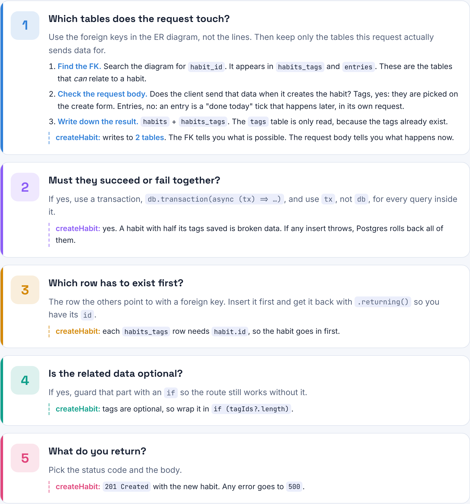
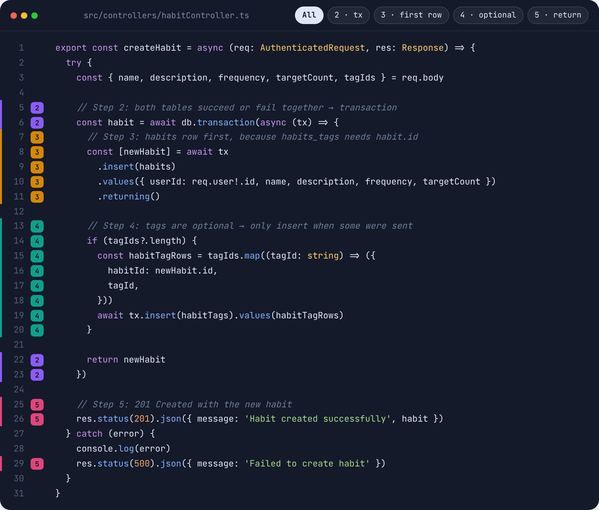
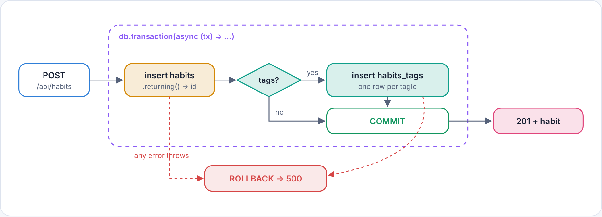
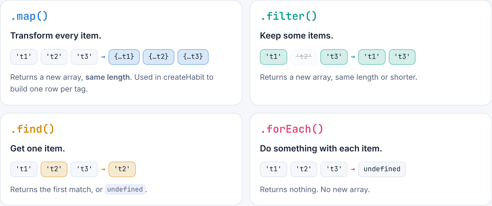

# 🧩 How to Write a Multi-Table Route

> **One-line summary:** Before you write a route that saves to more than one table, answer **five questions in order**: *which tables*, *all-or-nothing?*, *which row first*, *what is optional*, *what do I return*. The answers write most of the code for you.

🎨 **Interactive version:** [Multi-Table Route Playbook](https://claude.ai/artifact/D1CEVj64yd8ndZjWNKbT94) (tap a step to light up its lines of code)
🔗 **Related notes:** [10 · Reading ER Diagrams](./10-reading-er-diagrams.md) · [19 · Understanding Tables and Their Relationships](./19-understanding-tables-and-relationships.md)

---

## 1. 🗺️ The 5 questions at a glance



| # | ❓ Ask yourself | ✅ What to do | 🏋️ In `createHabit` |
| :-: | --- | --- | --- |
| 🔵 **1** | **Which tables does the request touch?** | Find the tables with an FK to yours, then keep only the ones the request body sends data for. | `habits` + `habits_tags` = **2 tables** |
| 🟣 **2** | **Must they succeed or fail together?** | Use `db.transaction(async (tx) => …)` and use **`tx`, not `db`**, inside it. | Yes. Half-saved tags = broken data. |
| 🟠 **3** | **Which row has to exist first?** | The row the others point to. Insert it first, get it back with **`.returning()`**. | `habits`, because `habits_tags` needs `habit.id` |
| 🟢 **4** | **Is the related data optional?** | Guard it with an **`if`**. | `if (tagIds?.length)` |
| 🔴 **5** | **What do you return?** | Choose the status code and body. | **`201`** + the habit (errors → `500`) |

### 🔵 Step 1 in detail: reading the diagram for it

1. **Find the FK.** Search the ER diagram for `habit_id`. It appears in `habits_tags` and `entries`. These tables **can** relate to a habit.
2. **Check the request body.** Does the client send that data when it **creates** the habit?
   - Tags ✅ picked on the create form → write `habits_tags`.
   - Entries ❌ an entry is a "done today" tick that happens **later**, in its own request (`POST /habits/:id/entries`).
3. **Write down the result:** `habits` + `habits_tags`. The `tags` table is only **read**: the tags already exist.

> 🧠 **The FK tells you what is possible. The request body tells you what happens now.**

> 💡 **Why step 2 matters:** if *any* query inside a transaction throws, Postgres **rolls back every query in it**, as if the request never happened. No orphan habits, no half-saved tags.

---

## 2. 🏗️ Worked example: `createHabit` with tags

**Request body:** `{ name, frequency, description?, targetCount?, tagIds?: string[] }`



```ts
export const createHabit = async (req: AuthenticatedRequest, res: Response) => {
  try {
    const { name, description, frequency, targetCount, tagIds } = req.body

    // 🟣 Step 2: both tables succeed or fail together → transaction
    const habit = await db.transaction(async (tx) => {
      // 🟠 Step 3: habits row first, because habits_tags needs habit.id
      const [newHabit] = await tx
        .insert(habits)
        .values({ userId: req.user!.id, name, description, frequency, targetCount })
        .returning()

      // 🟢 Step 4: tags are optional → only insert when some were sent
      if (tagIds?.length) {
        const habitTagRows = tagIds.map((tagId: string) => ({
          habitId: newHabit.id,
          tagId,
        }))
        await tx.insert(habitTags).values(habitTagRows)
      }

      return newHabit
    })

    // 🔴 Step 5: 201 Created with the new habit
    res.status(201).json({ message: 'Habit created successfully', habit })
  } catch (error) {
    console.log(error)
    res.status(500).json({ message: 'Failed to create habit' })
  }
}
```

### 🔍 Line by line

| Code | Step | What it does |
| --- | :-: | --- |
| `db.transaction(async (tx) => …)` | 🟣 2 | Opens a transaction. Whatever the callback returns becomes the result of `await db.transaction(...)`. |
| `tx.insert(habits)…returning()` | 🟠 3 | Saves the habit and hands back the saved row with its database-made `id`. Always an **array**, hence `const [newHabit]`. |
| `if (tagIds?.length)` | 🟢 4 | Skips the tag insert when `tagIds` is missing or `[]`. The `?.` stops a crash on `undefined`. |
| `tagIds.map(...)` | 🟢 4 | Turns `['t1', 't2']` into `[{ habitId, tagId: 't1' }, { habitId, tagId: 't2' }]`. |
| `tx.insert(habitTags).values(rows)` | 🟢 4 | **One** `INSERT` with many rows, inside the same transaction. |
| `res.status(201)` | 🔴 5 | `201 Created` = a new resource exists now. |

---

## 3. ⚙️ What happens at runtime



```
POST /api/habits
   │
   ▼
┌─────────────────── db.transaction(tx) ───────────────────┐
│  insert habits ──► tags sent? ──yes──► insert habits_tags │
│  (.returning id)        │no                  │            │
│                         └──────► COMMIT ◄────┘            │
└──────────────────────────────┬───────────────────────────┘
        any error ► ROLLBACK ► 500         │
                                           ▼
                                    201 + habit
```

---

## 4. 🧠 Rule of thumb: `map` / `filter` / `find` / `forEach`

> Ask **what you want back**: a same-length array, a smaller array, one item, or nothing.



| Method | Use it to | Gives back |
| --- | --- | --- |
| 🔵 `map` | **Transform** every item | New array, **same length** |
| 🟢 `filter` | **Keep some** items | New array, same or shorter |
| 🟠 `find` | **Get one** item | First match, or `undefined` |
| 🔴 `forEach` | **Do something** with each item | Nothing (`undefined`) |

```ts
const tagIds = ['t1', 't2', 't3']

tagIds.map((id) => ({ habitId: 'h1', tagId: id }))   // 3 objects → rows to insert
tagIds.filter((id) => id !== 't2')                    // ['t1', 't3']
tagIds.find((id) => id.startsWith('t2'))              // 't2'
tagIds.forEach((id) => console.log(id))               // logs 3 lines, returns undefined
```

In `createHabit`, **`map`** is the right one: every tag id becomes exactly one row.

> ⚠️ **Interview trap:** `forEach` with an `async` callback does **not** wait.
> Use `for (const x of items) await …` (one by one) or `await Promise.all(items.map(async (x) => …))` (all together).

---

## 5. 🎯 Interview check

<details>
<summary><b>Why <code>tx</code> instead of <code>db</code> inside the transaction?</b></summary>

Queries on `tx` run on the transaction's own connection, so a rollback undoes them. A query on `db` runs **outside** the transaction and stays saved even if everything else is rolled back.
</details>

<details>
<summary><b>What breaks if you insert <code>habits_tags</code> before <code>habits</code>?</b></summary>

There is no `habit.id` yet, and the FK `habits_tags.habit_id → habits.id` rejects the row. The parent row always goes in first.
</details>

<details>
<summary><b>The client sends <code>tagIds: []</code>. What happens?</b></summary>

`[].length` is `0`, so the `if` skips the tag insert. The habit is still created → `201`. Without the guard, Drizzle throws on an empty `values([])`.
</details>

<details>
<summary><b>One <code>tagId</code> does not exist. What does the user get?</b></summary>

The FK on `tag_id` rejects the insert, the whole transaction rolls back (the habit is **not** saved either), and the route returns `500`. A better API checks the tags first and returns `400`.
</details>

---

### 📌 Remember

> **Tables → together? → first row → optional? → return.**
> Reuse it for any route that writes to more than one table, like an order with its order items.
