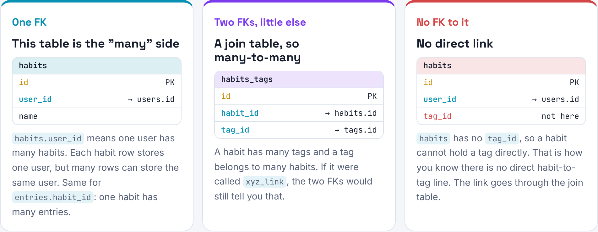
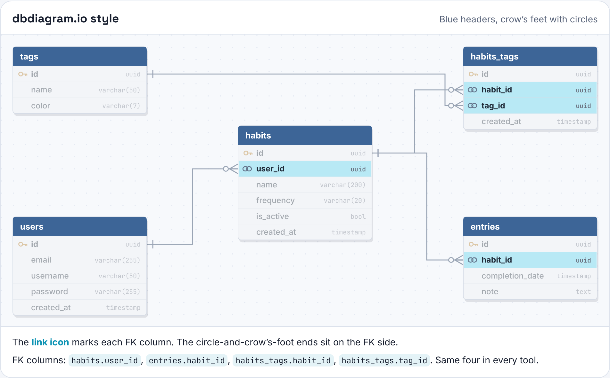
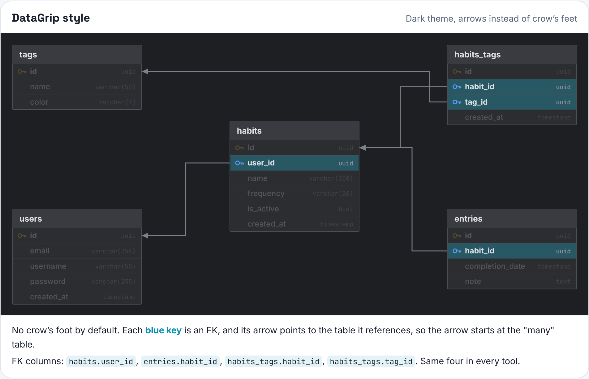
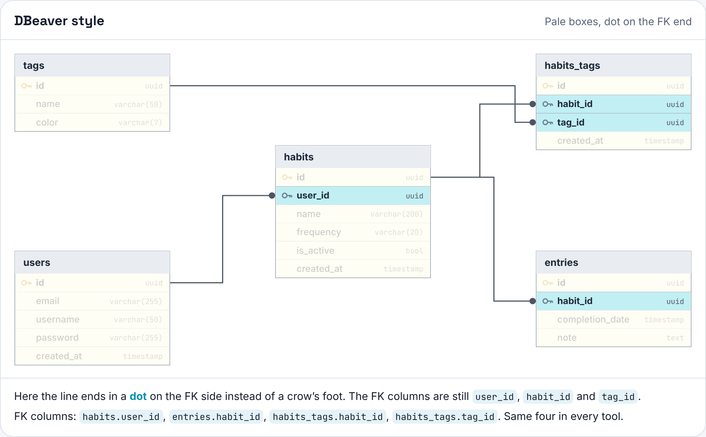
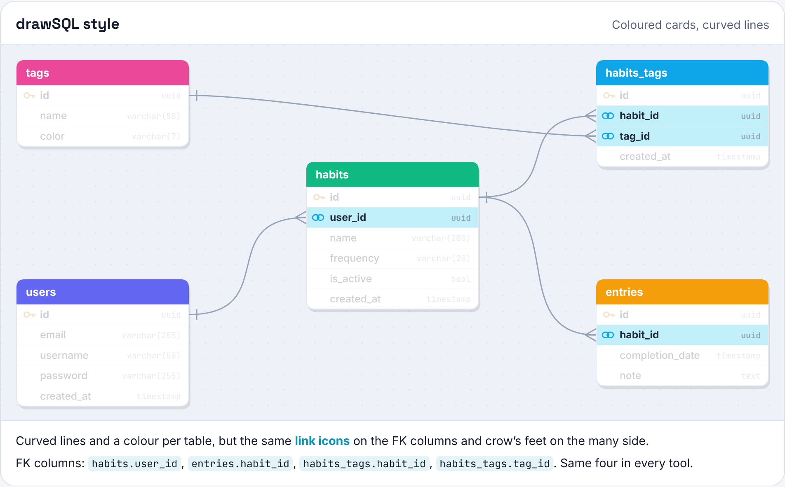
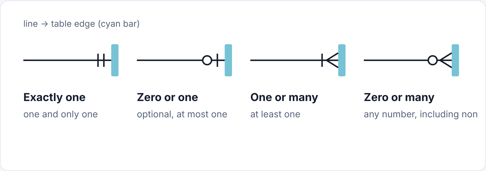
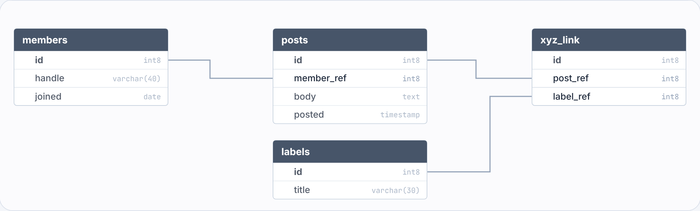

# 🔑 Understanding Tables and Their Relationships

> **One-line summary:** To read **any** ER diagram, in **any** tool, ignore the lines at first and **find the foreign key columns** (usually `something_id`, marked with a 🔗 link or key icon). The columns tell you the relationships. The lines only repeat what the columns already say.

🎨 **Interactive version:** [Reading Any ER Diagram](https://claude.ai/artifact/GCByf2DsRb2Yjwzd8qUoz4) (has a "Highlight foreign keys" button)
🔗 **Related notes:** [10 · Reading ER Diagrams](./10-reading-er-diagrams.md) · [13 · Drizzle `relations()`](./13-drizzle-relations-from-diagrams.md) · [18 · Multi-Table Routes](./18-writing-a-multi-table-route.md)

---

## 1. 📏 The rule: count the FKs in each table



| FKs in the table | 🧠 What it means | 🏋️ Habit tracker example |
| :-: | --- | --- |
| **1️⃣ One FK** | This table is on the **"many"** side | `habits.user_id` → one user has **many** habits. `entries.habit_id` → one habit has **many** entries. |
| **2️⃣ Two FKs, little else** | It is a **join table** → **many-to-many** | `habits_tags` has `habit_id` + `tag_id` → a habit has many tags **and** a tag belongs to many habits. |
| **🚫 No FK to that table** | **No direct link** | `habits` has no `tag_id`, so a habit can't hold a tag directly. The link goes **through** `habits_tags`. |

> 💡 **Names don't matter.** If `habits_tags` were called `xyz_link`, its two FKs would still tell you it is a many-to-many join table.

### Why "the table holding the FK is the many side"

```
users                     habits
┌────┬────────┐           ┌────┬──────────┬─────────────┐
│ id │ email  │           │ id │ user_id  │ name        │
├────┼────────┤           ├────┼──────────┼─────────────┤
│ u1 │ a@x.io │ ◄──────── │ h1 │ u1       │ Read        │
│    │        │ ◄──────── │ h2 │ u1       │ Run         │
│    │        │ ◄──────── │ h3 │ u1       │ Meditate    │
└────┴────────┘           └────┴──────────┴─────────────┘
 one row                   MANY rows can repeat u1
```

Each habit row stores **one** user. But **many** habit rows can store the **same** user. So: one user ➜ many habits.

---

## 2. 🖼️ Same schema, four tools, same rule

The same five tables drawn in the style of four tools, with the **FK columns highlighted**. The colours, icons and line endings change. **The FK columns never do.**

### dbdiagram.io style: blue headers, crow's feet with circles


### DataGrip style: dark theme, arrows instead of crow's feet


### DBeaver style: pale boxes, a dot on the FK end


### drawSQL style: coloured cards, curved lines


In all four, the FK columns are the same: `habits.user_id`, `entries.habit_id`, `habits_tags.habit_id`, `habits_tags.tag_id`.

### 🧾 Cheat sheet: how each tool marks things

| Tool | 🔑 Primary key | 🔗 Foreign key | "Many" end of a line |
| --- | --- | --- | --- |
| **dbdiagram.io** | Key icon, bold | Link icon | Crow's foot, with a circle when zero is allowed |
| **DataGrip** | Gold key | Blue key | No crow's foot by default. An **arrow** points from the FK column to the table it references |
| **DBeaver** | Gold key, bold | Grey key / link | Depends on the notation setting. Often a dot or crow's foot on the FK side |
| **drawSQL** | Key icon | Link icon | Crow's foot on curved lines |
| **Any tool, or none** | the `id` column | `something_id` pointing elsewhere | The table that **holds** the FK |

> ⚠️ These pictures approximate each tool's default look. Icons and line endings change with the version, theme and notation setting. That's exactly why you trust the **columns**, not the drawing.

---

## 3. 🐦 Crow's foot notation



| Symbol at the end | Name | Means |
| :-: | --- | --- |
| `──┼┼` | Exactly one | one and only one |
| `──o┼` | Zero or one | optional, at most one |
| `──┼<` | One or many | at least one |
| `──o<` | Zero or many | any number, including none |

**How to read it:** start at one table, follow the line, and say the symbol at the **far** end.
The mark **nearest the table** is the **maximum** (one or many). The mark **further out** is the **minimum** (zero or one).

> 🗣️ *"Reading from users to habits, I see a crow's foot with a circle at the habits end, so one user has zero or many habits."*

---

## 4. 🪤 The confusing line: "does a habit have one tag?"

| ❌ The trap | ✅ What it really says |
| --- | --- |
| In the dbdiagram picture, the line from `tags` runs toward the `habits` box with a single bar near `tags`. It **looks** like "a habit has one tag". | The line only **passes behind** `habits`. It ends on `habits_tags.tag_id`, the "many" side. `habits` has **no** `tag_id`, and `habits_tags` has **two** FKs. So habits ↔ tags is **many-to-many**. |

> 📌 Always check **which column a line ends on**, not where it happens to be drawn.

---

## 5. 🎯 Interview drill: a diagram with bad names

No helpful names. No line endings. Only columns.



<details>
<summary><b>Answer: what are the relationships?</b></summary>

1. `posts` has **one** FK, `member_ref` → members. So **one member has many posts**.
2. `xyz_link` has **two** FKs and nothing else. It's a **join table** → posts ↔ labels is **many-to-many**.
3. `posts` has no `label_ref`, so there is **no direct** post-to-label link.
4. `members` and `labels` have no FKs. They are **top-level** tables that others point to.
</details>

<details>
<summary><b>How to say it in an interview</b></summary>

> 🗣️ *"I start with the foreign keys, because the lines can be drawn any way. Posts has one foreign key to members, so a member has many posts. xyz_link has two foreign keys and no other data, so it's a join table, and posts and labels are many-to-many. Posts has no label column, so the only path from a post to its labels is through xyz_link."*

**Bonus depth:** a `UNIQUE (post_ref, label_ref)` constraint stops the same label being attached twice, and `ON DELETE CASCADE` on both FKs cleans up link rows when a post or label is deleted.
</details>

<details>
<summary><b>What if the diagram has 20 tables?</b></summary>

Same rule, one table at a time. Write a quick list:

| Table | FK columns | So… |
| --- | --- | --- |
| users | none | 🌳 root table |
| habits | `user_id` | 1:N under users |
| habits_tags | `habit_id`, `tag_id` | 🌉 join table → M:N |

Zero FKs = **roots**. One FK = **hangs under a parent**. Two FKs and little else = **join table**. The whole diagram falls out of that list, however the lines are drawn.
</details>

---

### 📌 Remember

> **Find the `_id` columns. One FK → many side. Two FKs → join table → many-to-many. No FK → no direct link.**
